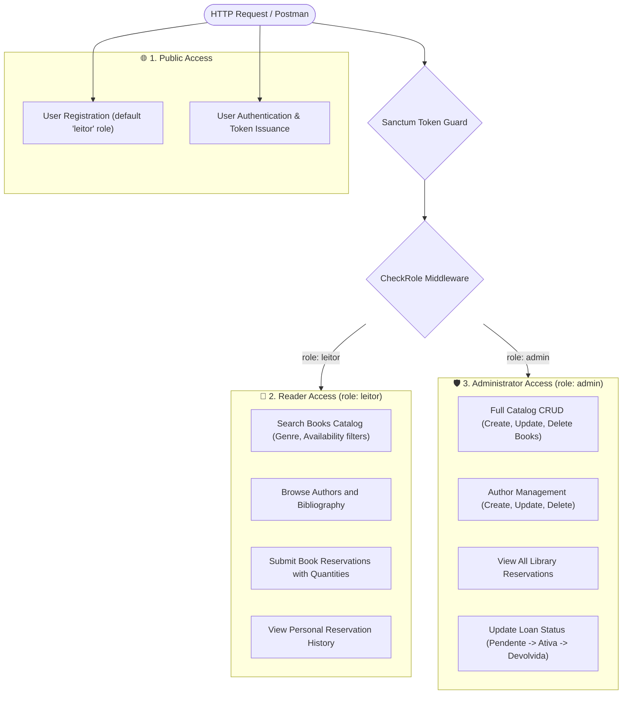
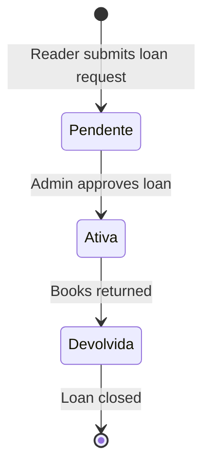

# 📚 Book Library & Reservation API

<p align="center">
  
  
  
  
  
</p>

A RESTful library catalog and reservation API built with **Laravel 11**, **Eloquent ORM**, and **Laravel Sanctum**.

It manages books, authors, and reader loan reservations with role-based permissions (Reader and Admin).

---

## ⚡ Access Hierarchy (RBAC)



---

## 📊 Database Schema (ERD)

```mermaid
erDiagram
    USERS {
        bigint id PK
        string name
        string email UK
        string password "Hashed"
        string role "leitor | admin"
        datetime created_at
    }

    AUTORES {
        bigint id PK
        string nome
        string nacionalidade
        date data_nascimento
        text biografia
        datetime created_at
    }

    LIVROS {
        bigint id PK
        string titulo
        string isbn UK
        int ano_publicacao
        string genero
        int exemplares_disponiveis
        bigint autor_id FK
        datetime created_at
    }

    RESERVAS {
        bigint id PK
        bigint user_id FK
        date data_reserva
        date data_devolucao
        string estado "pendente | ativa | devolvida"
        datetime created_at
    }

    LIVRO_RESERVA {
        bigint id PK
        bigint livro_id FK
        bigint reserva_id FK
        int quantidade
        datetime created_at
    }

    AUTORES ||--o{ LIVROS : "writes"
    USERS ||--o{ RESERVAS : "books"
    RESERVAS ||--o{ LIVRO_RESERVA : "contains"
    LIVROS ||--o{ LIVRO_RESERVA : "included_in"
```



---

## 🔄 Reservation Status Lifecycle



---

## ✨ Features

* **Role-Based Access Control:** Custom `CheckRole` middleware isolates reader actions from administrative management.
* **Many-to-Many Pivot Table:** Intermediate table (`livro_reserva`) stores requested copy quantities per reservation.
* **Catalog Filtering:** Eloquent queries support filtering books by genre and availability (`?genero=Romance&disponivel=true`).
* **Date Validation:** Enforces circulation rules ensuring loan start dates are not in the past and return dates occur after start dates.
* **Automated Feature Tests:** Test suite verifying authentication, catalog queries, reservation workflows, and role restrictions.

---

## 📑 API Endpoints Reference

### 🔐 Authentication (`/api`)

| Method | Endpoint | Access | Description |
| :--- | :--- | :--- | :--- |
| `POST` | `/api/register` | Public | Register new user (defaults to `leitor`) |
| `POST` | `/api/login` | Public | Authenticate and issue Sanctum token |
| `GET` | `/api/me` | 🔒 Authenticated | Get authenticated user profile |
| `POST` | `/api/logout` | 🔒 Authenticated | Revoke access token |

### 📚 Catalog (Books & Authors)

| Method | Endpoint | Access | Description |
| :--- | :--- | :--- | :--- |
| `GET` | `/api/livros` | 🔒 Authenticated | List books (`?genero=Poesia&disponivel=true`) |
| `GET` | `/api/livros/{id}` | 🔒 Authenticated | Get book details |
| `POST` | `/api/livros` | 🛡️ Admin Only | Create new book in catalog |
| `PUT` | `/api/livros/{id}` | 🛡️ Admin Only | Update book information |
| `DELETE` | `/api/livros/{id}` | 🛡️ Admin Only | Remove book from catalog |
| `GET` | `/api/autores` | 🔒 Authenticated | List authors with book counts |
| `GET` | `/api/autores/{id}` | 🔒 Authenticated | Get author details |
| `POST` | `/api/autores` | 🛡️ Admin Only | Create author record |
| `PUT` | `/api/autores/{id}` | 🛡️ Admin Only | Update author record |
| `DELETE` | `/api/autores/{id}` | 🛡️ Admin Only | Remove author record |

### 📅 Book Reservations (`/api/reservas`)

| Method | Endpoint | Access | Description |
| :--- | :--- | :--- | :--- |
| `GET` | `/api/reservas/minhas` | 📖 Reader Only | List reader's own reservations |
| `POST` | `/api/reservas` | 📖 Reader Only | Create reservation request |
| `GET` | `/api/reservas` | 🛡️ Admin Only | View all reservations (paginated) |
| `PATCH` | `/api/reservas/{id}` | 🛡️ Admin Only | Update status (`pendente`, `ativa`, `devolvida`) |

---

## 🔑 Pre-Configured Test Accounts (Seeders)

| Role | Email | Password | Privileges |
| :--- | :--- | :--- | :--- |
| **Administrator** | `admin@biblioteca.pt` | `admin123` | Full catalog CRUD & reservation status management |
| **Reader (`leitor`)** | `joao@exemplo.pt` | `leitor123` | Book search, reservation submissions, and personal history |

---

## 🛠️ Getting Started

### Prerequisites
* **PHP 8.3+** with SQLite extension
* **Composer**

### 1. Clone the repository
```bash
git clone https://github.com/Afonsojlc/book-library-api.git
cd book-library-api
```

### 2. Install dependencies
```bash
composer install
```

### 3. Environment setup
```bash
cp .env.example .env
php artisan key:generate
```
Ensure your `.env` contains:
```env
DB_CONNECTION=sqlite
```

### 4. Database initialization & seed
```bash
touch database/database.sqlite
php artisan migrate:fresh --seed
```

### 5. Run the server
```bash
php artisan serve
```
The API will be available at: `http://127.0.0.1:8000/api`

---

## 🧪 Running Tests

To run the feature test suite:
```bash
php artisan test
```

---

## 📬 Testing with Postman

Postman files are included in the [`Postman/`](Postman/) directory:
* [`Postman/book-library-api.postman_collection.json`](Postman/book-library-api.postman_collection.json)
* [`Postman/book-library-api.postman_environment.json`](Postman/book-library-api.postman_environment.json)

1. Import both JSON files into Postman.
2. Select the **Book Library API** environment.
3. Run the **Login** request to authenticate and automatically populate the `{{token}}` variable.

---

## 📁 Project Structure

```text
book-library-api/
├── app/
│   ├── Http/
│   │   ├── Controllers/          # Auth, Autor, Livro, Reserva controllers
│   │   └── Middleware/           # CheckRole middleware
│   └── Models/                   # Autor, Livro, Reserva, User models
├── database/
│   ├── migrations/               # Schema definitions
│   └── seeders/                  # Demo seeders
├── routes/
│   └── api.php                   # API route declarations
├── tests/
│   └── Feature/
│       └── BookLibraryApiTest.php # Feature tests
├── Postman/                      # Postman collections
├── composer.json
└── README.md
```

---

## 👤 Author

**Afonso Carvalho**  
* GitHub: [@Afonsojlc](https://github.com/Afonsojlc)  
* LinkedIn: [Afonso Carvalho](https://www.linkedin.com/in/afonso-carvalho-64796328a/)

---

## 📄 License

This project is licensed under the [MIT License](LICENSE).
